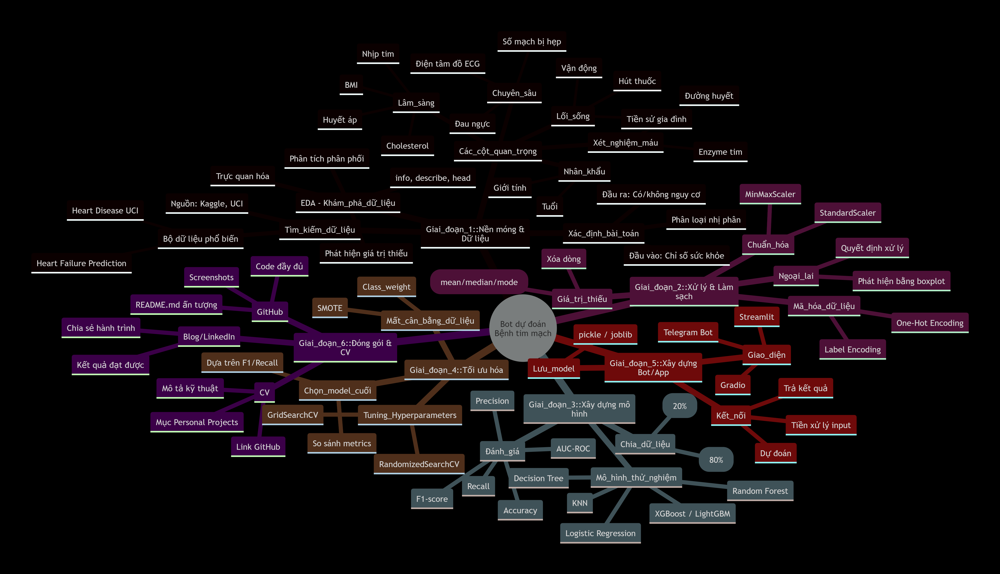
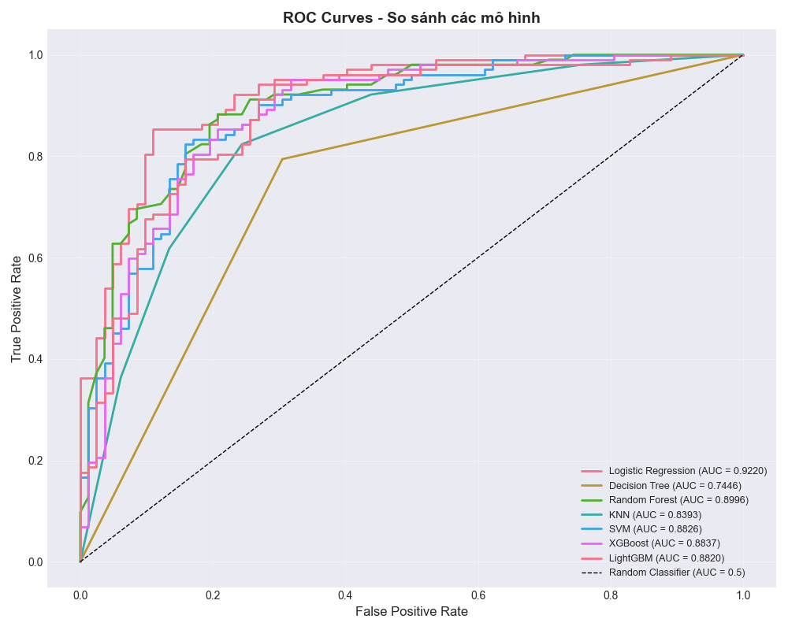
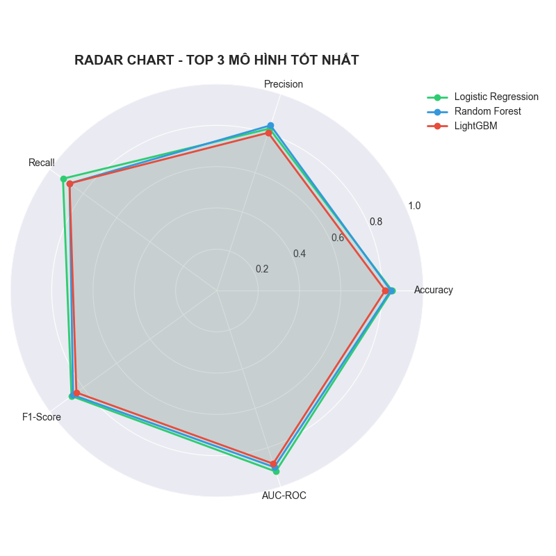

# ❤️ HeartGuard — Hệ thống Đánh giá Nguy cơ Tim mạch & Trợ lý Sức khỏe AI

**HeartGuard** là ứng dụng web Full-Stack tích hợp **Machine Learning** và **LLM (Groq Cloud)** giúp người dùng chủ động đánh giá nguy cơ mắc bệnh tim mạch dựa trên các chỉ số lâm sàng, lưu trữ lịch sử theo dõi cá nhân, xuất phiếu kết quả PDF (chuẩn A4) và trò chuyện trực tiếp với trợ lý sức khỏe AI.

---

## ✨ Tính năng nổi bật

### 1. Đánh giá nguy cơ tim mạch đa bước (Multi-Step Clinical Assessment)
- **Biểu mẫu 3 bước trực quan:** Kiểm tra hợp lệ từng trường dữ liệu theo khoảng lâm sàng trước khi chuyển bước.
- **Tự động điền từ Hồ sơ sức khỏe:** Lấy nhanh các chỉ số cơ bản (tuổi, giới tính, chiều cao, cân nặng, huyết áp, cholesterol) từ hồ sơ cá nhân mà không ghi đè dữ liệu đang nhập.
- **Kết quả kép:** Kết hợp **Giá trị dự đoán từ mô hình Machine Learning (Random Forest)** và **Điểm đánh giá lâm sàng (Clinical Score)** kèm khuyến nghị cụ thể theo 4 mức nguy cơ (`THẤP`, `TRUNG BÌNH`, `CAO`, `RẤT CAO`) và chỉ số **BMI** tự động.
- **Snapshot & In phiếu A4 / Xuất PDF:** Chụp nguyên trạng dữ liệu đầu vào tại thời điểm đánh giá để lưu lịch sử chống trùng lặp và in phiếu kết quả chuẩn A4 trực tiếp trên trình duyệt.

### 2. Trợ lý Sức khỏe AI (HeartGuard Chatbot)
- Tích hợp **Groq Cloud API** (`openai/gpt-oss-20b` mặc định) với ngữ cảnh hội thoại thông minh (giới hạn ngân sách token và độ dài lịch sử).
- Quản lý hạn mức lượt hỏi theo hạng tài khoản (**Free / Premium**) kèm tính năng nâng cấp tài khoản qua mã QR.

### 3. Quản lý Hồ sơ & Lịch sử Đánh giá
- **Xác thực bảo mật:** Đăng ký, đăng nhập với mật khẩu băm `bcrypt` và xác thực phiên bằng `JWT`.
- **Tra cứu & Phân trang nhanh:** Tìm kiếm lịch sử theo tên phiếu hoặc mức độ nguy cơ với **SWR** (tự động prefetch khi di chuột, debounce tìm kiếm 300ms, giao diện bảng trên Desktop và thẻ gọn trên Mobile).
- **Đa ngôn ngữ (i18n):** Hỗ trợ chuyển đổi Tiếng Việt (`VI`) và Tiếng Anh (`EN`).

---

## 🛠️ Điểm nhấn Kỹ thuật (Engineering Highlights)

| Hạng mục | Giải pháp kỹ thuật đã triển khai |
|---|---|
| **Frontend Architecture** | **Next.js 16 (App Router)**, **React 19**, **TypeScript**, **Tailwind CSS**. Tách biệt rõ tầng giao diện (`components/`), trạng thái phiên (`lib/client-session.ts`), logic kiểm định (`lib/assessment.ts`) và SWR data fetching (`lib/history.ts`). |
| **Code Splitting & Bundle** | Lazy-load khung Chatbot và thư viện `react-markdown` (`components/chatbot/lazy-heart-chatbot.tsx`), giảm dung lượng JS tải ban đầu trên trang chẩn đoán. |
| **Backend Concurrency** | **FastAPI** sử dụng threadpool cho các tác vụ đồng bộ (MySQL, `bcrypt`, `scikit-learn` inference) để không chặn async event loop; đóng kết nối DB trước khi gọi mạng ra Groq API. |
| **Database & Indexing** | **MySQL Connection Pool** (`DB_POOL_SIZE` cấu hình linh hoạt, trả `503 + Retry-After` khi quá tải) kèm script migration đánh chỉ mục phức hợp `(user_id, timestamp, id)` cho lịch sử dự đoán và chatbot. |
| **Automated Testing** | **33 bài kiểm thử tự động** (13 unit test Frontend bằng Node test runner + 20 unit test Backend bằng `unittest` với Mock Transport/DB) cùng bộ kiểm thử giao diện tự động bằng Playwright (`scripts/check-ui.cjs`) và công cụ bắn tải (`scripts/load_test.py`). |

---

## 🏗️ Kiến trúc Hệ thống & Cấu trúc Thư mục



Cấu trúc thư mục đã được chuẩn hóa, tách biệt rõ **Frontend**, **Backend API**, **Model Artifacts**, **Data/Notebooks** và **Tests**:

```text
heart-predict/
├── app/                        # Next.js App Router (Các trang giao diện)
│   ├── diagnosis/              # Trang đánh giá nguy cơ tim mạch 3 bước
│   ├── history/                # Trang tra cứu lịch sử đánh giá
│   ├── login/ & register/      # Trang đăng nhập & đăng ký
│   ├── profile/                # Trang quản lý hồ sơ sức khỏe cá nhân
│   └── page.tsx                # Trang chủ cổng thông tin HeartGuard
├── components/                 # Các React Component theo từng miền (Domain)
│   ├── auth/                   # AuthShell, LoginFormAPI, RegisterFormAPI
│   ├── chatbot/                # HeartChatbot & Lazy wrapper
│   ├── diagnosis/              # MultiStepDiagnosisForm, ResultDisplay, AssessmentActions
│   ├── history/                # HistoryTable (Responsive Desktop/Mobile + SWR)
│   ├── profile/                # ProfileForm (Cập nhật chỉ số & nâng cấp Premium)
│   └── ui/                     # Base UI primitives (Button, Card, Input, Label, Select)
├── lib/                        # Thư viện tiện ích Frontend
│   ├── i18n/                   # Quản lý đa ngôn ngữ (VI / EN)
│   ├── api-config.ts           # Cấu hình endpoint kết nối FastAPI
│   ├── api-errors.ts           # Chuẩn hóa thông báo lỗi từ API / Gateway
│   ├── assessment.ts           # Kiểm tra dữ liệu từng bước & tạo snapshot
│   ├── client-session.ts       # Quản lý JWT token đồng bộ trên trình duyệt
│   └── history.ts              # SWR fetcher, key builder & cache invalidation
├── api/                        # Backend FastAPI (Python)
│   ├── app/
│   │   ├── routers/            # Các API route: users.py, predictions.py, chatbot.py
│   │   ├── auth.py             # Xác thực & giải mã JWT
│   │   ├── config.py           # Đọc & kiểm tra biến môi trường
│   │   ├── database.py         # MySQL Connection Pool & khởi tạo bảng
│   │   ├── ml.py               # Tiền xử lý đầu vào, tính BMI, Clinical Score & chạy ML inference
│   │   ├── schemas.py          # Pydantic schemas kiểm định dữ liệu đầu vào/đầu ra
│   │   └── state.py            # Quản lý vòng đời Model, DB Pool & HTTPX AsyncClient
│   ├── main.py                 # Entrypoint khởi chạy FastAPI & Lifespan
│   ├── migrate_indexes.py      # Script tạo chỉ mục (Index) tối ưu truy vấn MySQL
│   └── requirements.txt        # Danh sách thư viện Python cho Backend
├── models/                     # Artifacts mô hình đã huấn luyện (.pkl)
│   ├── random_forest_model.pkl # Mô hình Random Forest Classifier
│   ├── heart_scaler.pkl        # Bộ chuẩn hóa StandardScaler
│   └── feature_names.pkl       # Danh sách 22 đặc trưng đầu vào của mô hình
├── data/                       # Dữ liệu thô & dữ liệu đã qua tiền xử lý
│   ├── raw_data/               # Bộ dữ liệu gốc UCI Heart Disease (920 bản ghi)
│   └── data_process/           # Dữ liệu đã xử lý phục vụ huấn luyện & ánh xạ cột
├── notebook/                   # Jupyter Notebooks nghiên cứu, EDA & huấn luyện mô hình
│   ├── heart_disease_eda.ipynb              # Notebook EDA tự động hóa (tái lập 100%)
│   ├── 01_data_preprocessing.ipynb          # Làm sạch dữ liệu, xử lý missing & chuẩn hóa
│   ├── 02_feature_engineering_and_rf.ipynb  # Tạo đặc trưng & xuất mô hình Random Forest
│   ├── 03_model_benchmarking.ipynb          # So sánh 7 thuật toán ML (SMOTE, GridSearchCV)
│   └── requirements-eda.txt                 # Thư viện bổ sung để chạy EDA notebook
├── docs/                       # Tài liệu kỹ thuật & hình ảnh trực quan hóa
│   ├── figures/                # Biểu đồ EDA (`eda/`), so sánh mô hình (`models/`), `mindmap/`
│   ├── GIAO_DIEN_VA_TINH_NANG_MOI.md
│   ├── PERFORMANCE.md
│   └── TROUBLESHOOTING.md
├── scripts/                    # Công cụ vận hành: run_eda.py, load_test.py, check-ui.cjs
└── tests/                      # Bộ kiểm thử tự động (Frontend .cjs & Backend .py)
```

---

## 🧠 Quy trình Khoa học Dữ liệu & Mô hình Học máy

Dự án sử dụng bộ dữ liệu **UCI Heart Disease** (920 bệnh nhân tổng hợp từ 4 trung tâm: Cleveland, Hungary, Switzerland, VA Long Beach) với 14 thuộc tính lâm sàng gốc, được mở rộng thành **22 đặc trưng đầu vào** sau bước Feature Engineering (mã hóa One-Hot các biến phân loại `cp`, `restecg`, `slope`, tạo tỷ số huyết áp/tuổi `bp_age_ratio`, phân nhóm tuổi và cờ dữ liệu khuyết).

### Kết quả thực nghiệm & So sánh 7 thuật toán (`notebook/03_model_benchmarking.ipynb`)
Quá trình thử nghiệm đánh giá 7 mô hình (*Logistic Regression, Random Forest, LightGBM, SVM, XGBoost, KNN, Decision Tree*) kết hợp kiểm định chéo **10-Fold Stratified Cross-Validation** và cân bằng dữ liệu **SMOTE**:

| Biểu đồ So sánh ROC-AUC | Biểu đồ Radar Top 3 Mô hình |
|---|---|
|  |  |

- **Triển khai hiện tại (`models/`):** Sử dụng `RandomForestClassifier` đóng gói qua `joblib` (`scikit-learn==1.8.0`) kết hợp song song với thang điểm lâm sàng (`calculate_clinical_score`) để cung cấp góc nhìn tham khảo đa chiều.
- **Định hướng nâng cấp Model v2 (Roadmap):** Đóng gói toàn bộ bước tiền xử lý và mô hình vào một `sklearn.pipeline.Pipeline` duy nhất kèm `model_card.json` (tối ưu ngưỡng phân loại theo **Recall / F2-score** để giảm thiểu tỷ lệ bỏ sót bệnh nhân có nguy cơ).

---

## 🚀 Hướng dẫn Cài đặt & Khởi chạy

### 1. Yêu cầu hệ thống
- **Node.js** ≥ 18
- **Python** ≥ 3.11 (khuyến nghị tạo môi trường ảo `.venv`; model được đóng gói với `scikit-learn==1.8.0`)
- **MySQL Server** ≥ 8.0

### 2. Cấu hình biến môi trường
Sao chép file mẫu `.env.example` sang `.env` ở thư mục gốc và điền thông tin kết nối:

```bash
cp .env.example .env
```

Các biến quan trọng trong `.env`:
- `NEXT_PUBLIC_API_LOCAL_URL`: Địa chỉ FastAPI dưới local (mặc định `http://127.0.0.1:8000`)
- `DB_HOST`, `DB_PORT`, `DB_USER`, `DB_PASSWORD`, `DB_NAME`: Thông tin kết nối MySQL cho FastAPI
- `JWT_SECRET_KEY`: Khóa bí mật dùng để ký JWT Token (bắt buộc thiết lập)
- `GROQ_API_KEY`, `GROQ_MODEL`: API Key và tên model trên Groq Cloud cho Chatbot

### 3. Khởi chạy Backend (FastAPI)

```powershell
# Tạo và kích hoạt môi trường ảo Python tại thư mục gốc
python -m venv .venv
.\.venv\Scripts\Activate.ps1

# Cài đặt thư viện cho API
pip install -r api/requirements.txt

# (Tùy chọn) Tạo index tối ưu cho MySQL nếu dùng DB đã có sẵn bảng
python api/migrate_indexes.py

# Khởi chạy server FastAPI tại cổng 8000
cd api
uvicorn main:app --reload --port 8000
```
- Tài liệu Swagger UI tự động tại: `http://localhost:8000/docs`
- Healthcheck endpoint: `http://localhost:8000/health`

### 4. Khởi chạy Frontend (Next.js)

```powershell
# Từ thư mục gốc của dự án
npm install
npm run dev
```
- Truy cập ứng dụng tại: `http://localhost:3000`

---

## 🧪 Kiểm thử & Đảm bảo Chất lượng (Testing & QA)

Dự án đi kèm bộ kiểm thử tự động chạy độc lập mà **không cần bật MySQL thật hay tốn phí gọi Groq API**:

```powershell
# 1. Chạy 13 bài kiểm thử đơn vị Frontend (Session, Validation, Snapshot, Error Parser)
node --test tests/client-session.test.cjs tests/assessment.test.cjs

# 2. Chạy 20 bài kiểm thử đơn vị & bất đồng bộ Backend (Auth, History SQL Injection, Groq Timeouts, Concurrency)
.\.venv\Scripts\python.exe -m unittest discover -s tests -p "test_*.py" -v

# 3. Kiểm tra TypeScript & Build Production của Next.js
npm run build
```

Để tái tạo toàn bộ thống kê và biểu đồ EDA từ dữ liệu gốc:
```powershell
.\.venv\Scripts\python.exe -m pip install -r notebook/requirements-eda.txt
.\.venv\Scripts\python.exe scripts/run_eda.py
```

Xem thêm tài liệu chi tiết trong thư mục [`docs/`](docs/):
- [Giao diện, tính năng mới & định hướng phát triển](docs/GIAO_DIEN_VA_TINH_NANG_MOI.md)
- [Kiến trúc hiệu năng, Database Index & Load Testing](docs/PERFORMANCE.md)
- [Hướng dẫn xử lý sự cố (Troubleshooting)](docs/TROUBLESHOOTING.md)

---

## 👤 Tác giả & Giấy phép

- **Tác giả:** Nguyễn Minh Tuấn — Sinh viên ngành Khoa học Dữ liệu, Trường Đại học Giao thông Vận tải TP.HCM (UTH).
- **Lưu ý Y khoa:** *Kết quả từ HeartGuard chỉ mang tính chất tham khảo hỗ trợ theo dõi sức khỏe cá nhân, không thay thế cho chẩn đoán hoặc chỉ định của bác sĩ chuyên khoa.*
