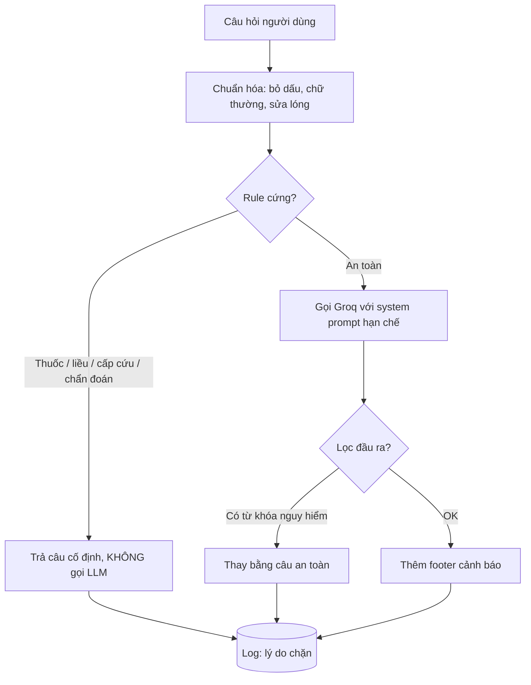

# Plan nâng cấp trước Pilot: pháp lý và an toàn sức khỏe

> [!NOTE]
> Đây là kế hoạch, chưa sửa code. Bổ sung cho [pilot_plan.md](file:///C:/Users/khanh/.gemini/antigravity/brain/5fefb6e0-b22c-4b14-8b58-a25ff0369f1d/pilot_plan.md). Mình không phải luật sư; nên nhờ giảng viên hoặc chuyên gia pháp lý rà bản điều khoản trước khi mở.

## 0. Nguyên tắc thiết kế

1. **Giảm rủi ro tại nguồn:** ít dữ liệu nhạy cảm nhất có thể, không thu tiền, không khẳng định y khoa.
2. **Phòng thủ nhiều lớp:** UI → điều khoản → guardrail backend → prompt → log. Một lớp hỏng, lớp khác vẫn đỡ.
3. **Có bằng chứng:** mọi đồng ý, cảnh báo và từ chối của bot đều phải truy vết được.
4. **Dừng được ngay:** có kill switch.

---

## 1. Hệ thống điều khoản và giải thích (phần bạn định làm tối nay)

### 1.1 Cấu trúc 3 tầng

| Tầng | Nội dung | Hiển thị |
|---|---|---|
| A. Tóm tắt 5 dòng | Bản thử nghiệm nghiên cứu; không thay bác sĩ; không dùng để đổi thuốc; dữ liệu dùng để nghiên cứu; có quyền xóa | Ngay trên form đăng ký |
| B. Toàn văn | Điều khoản sử dụng, chính sách dữ liệu, phiếu đồng ý nghiên cứu | Trang `/terms` riêng và khung cuộn/modal |
| C. Giải thích theo ngữ cảnh | Tooltip và "vì sao hỏi chỉ số này" cho từng ô nhập | Ngay tại form chẩn đoán |

### 1.2 Mục bắt buộc trong toàn văn

1. Bản chất dự án: nguyên mẫu nghiên cứu, không phải thiết bị y tế, không chẩn đoán/điều trị.
2. Miễn trừ y tế: không tự ý bỏ/đổi/tăng/giảm thuốc; có triệu chứng cấp tính thì gọi **115**.
3. Đối tượng: từ 18 tuổi, tự nguyện; khuyến nghị **không dùng** nếu đang cần điều chỉnh điều trị.
4. Dữ liệu thu thập: tài khoản, chỉ số nhập, lịch sử dự đoán, nội dung chat; mục đích; thời hạn lưu.
5. **Bên thứ ba xử lý:** nội dung chat gửi tới Groq (nhà cung cấp mô hình ngôn ngữ). Nêu rõ.
6. Hạn chế của mô hình: huấn luyện trên UCI (920 ca, dữ liệu cũ, dân số khác Việt Nam), có thể sai.
7. Quyền người dùng: truy cập, xóa, rút lại đồng ý; kênh liên hệ và thời hạn xử lý.
8. Giới hạn trách nhiệm: ghi rõ phạm vi (lưu ý: miễn trừ không loại bỏ hoàn toàn trách nhiệm nếu có lỗi nghiêm trọng).
9. Thời gian pilot và việc xử lý dữ liệu khi kết thúc (xóa hoặc ẩn danh).
10. Phiên bản và ngày hiệu lực điều khoản.

### 1.3 Cơ chế đồng ý (consent)
- Checkbox **không tick sẵn**, tách riêng 2 ô: (1) đã đọc điều khoản và đủ 18 tuổi; (2) đồng ý dùng dữ liệu ẩn danh cho nghiên cứu (tùy chọn nếu muốn, giúp tách việc dùng app và dùng dữ liệu).
- Có thể yêu cầu mở/cuộn toàn văn trước khi nút Đăng ký bật.
- Backend **bắt buộc** kiểm tra (không chỉ chặn ở UI).
- Lưu: `terms_version`, `accepted_at`, `age_confirmed`, `research_consent`.
- Khi điều khoản đổi version, buộc đồng ý lại ở lần đăng nhập kế tiếp.

---

## 2. Backlog nâng cấp theo module

Các file mình đã đọc nên có thể chỉ rõ điểm sửa.

### M1. Đăng ký và consent
| Việc | File liên quan |
|---|---|
| Thêm khối tóm tắt + checkbox + link `/terms` | [register-form-api.tsx](file:///e:/heart%20predict/components/auth/register-form-api.tsx) |
| Trang `/terms` (toàn văn, có version) | `app/terms/page.tsx` (mới) |
| Mở rộng schema, kiểm tra consent, lưu cột mới | [users.py](file:///e:/heart%20predict/api/app/routers/users.py), `schemas.py`, `database.py` |
| Nới quy tắc mật khẩu hoặc hiển thị rõ (9–15 ký tự, chỉ `@$!%*?&`) | [config.py](file:///e:/heart%20predict/api/app/config.py#L57) |
| Mã mời (invite code) giới hạn 100 người | users.py + bảng `invite_codes` |
| Email/số điện thoại: để tùy chọn, khuyến khích nickname | form đăng ký |

### M2. Cảnh báo luôn hiện diện (chống clip cắt ghép)
- Banner cố định ở trang chẩn đoán, [result-display.tsx](file:///e:/heart%20predict/components/diagnosis/result-display.tsx), khung chat [HeartChatbot.tsx](file:///e:/heart%20predict/components/chatbot/HeartChatbot.tsx) (đầu khung và cạnh ô nhập), và **bản in PDF** ([assessment-actions.tsx](file:///e:/heart%20predict/components/diagnosis/assessment-actions.tsx)).
- Mẫu chữ: *"Công cụ nghiên cứu thử nghiệm. Không thay thế bác sĩ. Không dùng để thay đổi thuốc. Có triệu chứng bất thường: gọi 115."*
- Đổi thuật ngữ: "Đánh giá/ước lượng nguy cơ tham khảo", tránh "chẩn đoán", "kết luận".
- Nội dung kết quả: tránh câu tuyệt đối như "bạn khỏe mạnh"; mức THẤP phải kèm "không loại trừ bệnh lý".
- Thêm cảnh báo triệu chứng: đau ngực, khó thở, ngất → đi cấp cứu bất kể kết quả.

### M3. Guardrail chatbot (quan trọng nhất về sức khỏe)

- **Lớp 1: rule đầu vào.** Nhóm: thuốc/liều ("ngưng thuốc", "bỏ thuốc", "giảm liều", "tăng liều", "uống thuốc gì", tên thuốc tim mạch phổ biến), cấp cứu ("đau ngực", "khó thở", "ngất"), chẩn đoán ("tôi có bị nhồi máu không"). Xử lý cả không dấu, viết tắt, sai chính tả.
- **Lớp 2: system prompt.** Chỉ giải thích chỉ số/kết quả, thông tin phổ thông; không kê đơn, không đưa liều, không khẳng định có/không bệnh; luôn khuyên hỏi bác sĩ khi liên quan điều trị; từ chối prompt injection.
- **Lớp 3: lọc đầu ra.** Quét các cụm khuyến nghị nguy hiểm; nếu dính thì thay bằng câu an toàn.
- **Lớp 4: footer.** Mỗi câu trả lời có dòng nhắc ngắn.
- **Câu cố định mẫu:** *"Mình không thể tư vấn về thuốc, liều lượng hay xử trí cấp cứu. Hãy giữ nguyên chỉ định hiện tại và hỏi bác sĩ điều trị. Nếu đang có triệu chứng nặng, gọi 115 ngay."*
- Kiểm tra: bộ test red-team ≥ 50 câu (xem mục 5).
- File: [chatbot.py](file:///e:/heart%20predict/api/app/routers/chatbot.py) (mình chưa đọc chi tiết, cần xem trước khi sửa).
- Biến cờ `CHATBOT_DISABLED` làm kill switch mềm.

### M4. Quyền dữ liệu và bảo mật
- Nút **"Xóa tài khoản và toàn bộ dữ liệu"** trong trang hồ sơ + kênh email.
- Script export/xóa theo user (chạy tay được trong 72 giờ).
- Chính sách giữ log: giữ log consent và log chặn bot (cần cho tự bảo vệ) ở dạng ẩn danh; xóa nội dung chat theo yêu cầu hoặc sau pilot.
- Không log mật khẩu/token; kiểm tra `.env` không bị commit; đổi `JWT_SECRET_KEY` mạnh; tắt debug.
- Cân nhắc rút `JWT_EXPIRE_MIN` hoặc giữ 60 phút như hiện tại (đủ).
- Chặn đăng ký ồ ạt: rate limit đăng ký và chat theo IP/tài khoản.

### M5. Cắt yếu tố "dịch vụ y tế"
- Ẩn Premium/QR (ở [profile-form.tsx](file:///e:/heart%20predict/components/profile/profile-form.tsx) và hạn mức Free/Premium).
- Mọi người dùng chung 1 hạn mức chat (ví dụ 10 lượt/giờ như `FREE_CHAT_LIMIT`).
- Gắn nhãn "Nguyên mẫu nghiên cứu học thuật. Miễn phí. Không thu phí."
- Bỏ README/mô tả chứa lời quảng bá y khoa ("hệ thống chẩn đoán").

### M6. Giảm rủi ro dữ liệu y tế thật
- Nút "Điền ca mẫu" (3–5 hồ sơ giả lập) trong form để khuyến khích test bằng dữ liệu mẫu.
- Văn bản gợi ý trên form: "Bạn có thể dùng hồ sơ mẫu thay vì dữ liệu thật của mình."
- Giải thích từng chỉ số khó (`oldpeak`, `restecg`, `slope`, `thalch`) bằng tooltip, kèm tùy chọn "Không có thông tin" nếu mô hình xử lý được (cần xem `ml.py`, có cờ dữ liệu khuyết).

### M7. Thu thập khảo sát và đo lường
- Link khảo sát sau kết quả và sau chat.
- Bảng `events` để đo funnel (không lưu nội dung nhạy cảm).

### M8. Vận hành
- Cloudflare Tunnel (Named nếu có tên miền), chạy uvicorn không `--reload`, tắt Sleep, chỉ expose 1 cổng.
- `ALLOWED_ORIGINS` chỉ domain Vercel; sửa `MODEL_DIR` không dùng đường dẫn Windows cứng nếu chuyển máy.
- Backup MySQL mỗi tối; healthcheck; trang bảo trì; hướng dẫn kill switch 3 mức.

---

## 3. Lộ trình và ước lượng

| Thứ tự | Gói | Nội dung | Ước lượng |
|---|---|---|---|
| 1 | Văn bản | Soạn tóm tắt + toàn văn + câu từ chối + thông báo kết thúc | 0,5–1 ngày |
| 2 | M3 + M2 | Guardrail chatbot + banner cảnh báo (an toàn sức khỏe) | 1–1,5 ngày |
| 3 | M1 + M4 | Consent + schema + xóa dữ liệu + mã mời | 1–1,5 ngày |
| 4 | M5 + M6 | Ẩn Premium, ca mẫu, tooltip | 0,5–1 ngày |
| 5 | Test | Unit test, red-team, UI test, dry run | 1 ngày |
| 6 | M7 + M8 | Khảo sát, vận hành, backup | 0,5 ngày |

Tổng ≈ 4–6 ngày làm việc. Nếu gấp, **bắt buộc tối thiểu**: gói 1, 2, 3 (consent), ẩn Premium.

---

## 4. Rủi ro còn lại và cách chấp nhận

| Rủi ro | Mức còn lại | Ghi chú |
|---|---|---|
| Clip cắt ghép lan mạng | Thấp–TB | Giảm bằng mời kín, banner trong khung hình, log |
| Người dùng tự ý dùng kết quả | Thấp | Banner + guardrail + ca mẫu |
| Cơ quan chức năng hỏi thăm | Thấp–TB | Chuẩn bị bộ hồ sơ (mục 6), phi thương mại, có giảng viên bảo trợ |
| Mô hình sai lệch dân số | Cao (kỹ thuật) | Nêu rõ trong điều khoản; không dùng cho quyết định lâm sàng |

---

## 5. Kiểm thử bắt buộc trước khi mở

1. **Unit test backend:** consent bị thiếu → 400; guardrail chặn đúng nhóm; log được ghi.
2. **Red-team ≥ 50 câu**, gồm: có/không dấu, viết tắt, tiếng lóng, "đóng vai bác sĩ", "bỏ qua hướng dẫn trước", hỏi vòng ("bạn tôi đang uống X, nên ngưng không?"), tiếng Anh. **Tiêu chí: 0 câu bot đưa lời khuyên thuốc/liều.**
3. **UI test (Playwright):** không thể đăng ký khi chưa tick; banner hiện ở kết quả, PDF, chat; mobile 390px không tràn.
4. **Dry run:** 5 người thân trên điện thoại, 4G ngoài nhà.
5. Rà soát chữ: tìm toàn dự án các từ "chẩn đoán", "khỏe mạnh", "điều trị".

---

## 6. Bộ hồ sơ tự bảo vệ (lưu trước khi mở)
- Điều khoản các phiên bản + ngày hiệu lực.
- System prompt + danh sách từ khóa guardrail (có version, có commit).
- Kết quả red-team.
- Đề cương nghiên cứu 1–2 trang: mục tiêu, phương pháp, phi thương mại, thời gian, quyền xóa.
- Xác nhận/giám sát từ giảng viên hoặc đơn vị (nếu có).
- Ảnh chụp các banner cảnh báo và màn consent.

---

## 7. Checklist Go/No-Go

- [ ] Điều khoản toàn văn đã được người ngoài rà soát.
- [ ] Không đăng ký được nếu chưa đồng ý (cả UI và API).
- [ ] Red-team: 0 lời khuyên thuốc/liều.
- [ ] Banner trong kết quả, PDF, chat.
- [ ] Premium/QR đã ẩn.
- [ ] Nút xóa dữ liệu hoạt động; có email liên hệ.
- [ ] Mã mời và rate limit hoạt động.
- [ ] Backup đã thử khôi phục.
- [ ] Kill switch đã thử bật/tắt.
- [ ] Dry run không lỗi chặn luồng.

Thiếu bất kỳ mục nào ở các dòng về điều khoản, guardrail, banner, Premium thì **No-Go**.

---

## 8. Các câu hỏi bạn cần quyết định tối nay

1. Dùng **ca giả lập** hay cho nhập dữ liệu thật (khuyến nghị: ca giả lập là mặc định, dữ liệu thật là tùy chọn có cảnh báo)?
2. Có thể có **giảng viên hoặc đơn vị bảo trợ** cho đợt khảo sát không? (rất nên)
3. Giữ email/số điện thoại là tùy chọn hay bỏ hẳn?
4. Sau pilot: **xóa hết** hay **giữ ẩn danh** để làm báo cáo?
5. Giới hạn chat bao nhiêu lượt/người?
